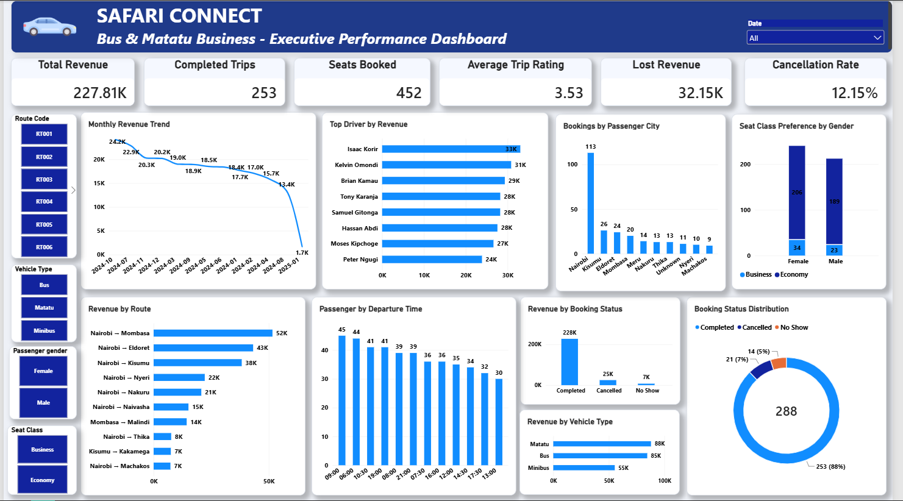

# Safari Connect | Bus & Matatu Booking Analytics

## Project Overview

Safari Connect is an end-to-end data analytics portfolio project focused on analyzing bus and matatu booking data to generate insights into transportation operations, revenue performance, customer behaviour, and booking outcomes.

The project uses SQL and PostgreSQL for data preparation and analysis, and Microsoft Power BI to develop an interactive dashboard that presents key performance indicators and business insights.

## Power BI Dashboard



The interactive report was developed in Power BI to explore booking performance, completed-trip revenue, route and driver performance, customer ratings, and cancellations.

## Key Business Findings

The analysis of Safari Connect booking data revealed the following:

- **Completed-trip revenue:** KES 227.81K from 253 completed trips.
- **Seat bookings:** 452 seats booked across completed trips.
- **Customer experience:** Average trip rating of 3.53 out of 5.
- **Booking outcomes:** 21 cancelled bookings and 14 no-shows, alongside 253 completed bookings.
- **Route performance:** Nairobi–Mombasa generated the highest revenue at approximately KES 52K, followed by Nairobi–Eldoret at KES 43K and Nairobi–Kisumu at KES 38K.
- **Vehicle performance:** Matatus generated approximately KES 88K, buses KES 85K, and minibuses KES 55K in completed-trip revenue.

## Business Recommendations

1. **Prioritize high-performing routes:** Review capacity allocation and service frequency on high-revenue routes while monitoring demand and operating costs.
2. **Investigate cancellations and no-shows:** Examine patterns by route, departure time, and booking status to identify opportunities to improve booking completion.
3. **Improve customer satisfaction:** Investigate lower-rated trips and use customer feedback to identify service improvements.
4. **Measure profitability:** Combine revenue with fuel, maintenance, staffing, and other operating expenses before making route or vehicle investment decisions.

*Note: Revenue figures describe completed trips. Fares associated with cancelled bookings or no-shows are not necessarily confirmed financial losses.*

## Business Problem

Transportation businesses need reliable information to understand which routes generate the most revenue, how drivers and vehicles perform, how customers use booking services, and how cancellations and no-shows affect booking outcomes.

This project explores these questions using booking data to support evidence-based operational and business decisions.

## Project Objectives

- Assess and improve data quality.
- Clean and validate booking data using SQL and PostgreSQL.
- Analyze route, driver, revenue, and passenger performance.
- Investigate cancellations and no-shows.
- Develop an interactive Power BI dashboard.
- Translate analytical results into actionable business recommendations.

## Tools and Technologies

- **PostgreSQL** — Data storage, cleaning, querying, and analysis.
- **SQL** — Data transformation, validation, and business analysis.
- **DBeaver** — Database management and SQL development.
- **Microsoft Power BI** — Data modelling, visualization, and dashboard development.
- **GitHub** — Project documentation and portfolio presentation.

## Project Status

The SQL analysis and Power BI dashboard have been developed. This repository documents the project workflow, analytical findings, dashboard, and business recommendations.

## Dataset Description

The project uses bus and matatu booking data that includes information on bookings, passengers, routes, vehicles, drivers, travel dates, seat selections, fares, payment methods, booking statuses, and trip ratings.

The dataset supports analysis of transportation operations, revenue performance, customer booking patterns, and trip outcomes.

## Data Quality Assessment

Before conducting the analysis, the dataset was assessed for quality issues that could affect the reliability of the results.

The issues identified included:

- **Duplicate records:** A duplicate booking ID was identified during the initial assessment.
- **Missing values:** Some passenger phone numbers, passenger cities, and trip ratings were missing.
- **Inconsistent date formats:** Travel-date values used different formats and required standardization.
- **Inconsistent text values:** Some categorical values, including booking statuses and seat classes, had inconsistent capitalization or formatting.
- **Inconsistent fare formatting:** Some fare values contained currency text such as `KES`.
- **Invalid values:** The initial assessment identified a negative seat-booking value and a trip rating outside the expected range.

These issues were considered during data preparation and validation to improve consistency and support reliable analysis.

## Data Preparation Approach

The project workflow included staging the source data, assessing data quality, cleaning inconsistent values, validating the prepared data, and using SQL queries and analytical views to support business analysis.

The specific cleaning and validation steps are documented in the project's SQL scripts.

## SQL Data Cleaning and Validation

PostgreSQL was used to prepare the booking data for analysis. DBeaver was used as the database development environment for executing SQL statements and inspecting results.

The workflow included the following stages:

1. **Staging:** Load the source data into a staging table before applying cleaning transformations.
2. **Data inspection:** Examine records, column values, missing values, duplicate identifiers, and inconsistent formats.
3. **Data cleaning:** Standardize date formats, text values, fare formatting, and other identified data-quality issues.
4. **Data validation:** Run SQL checks to assess the consistency and validity of the prepared data.
5. **Production table preparation:** Store the prepared booking data in the analytical database table.
6. **Analytical preparation:** Use SQL queries, views, and indexes to support the business analysis.

The validation stage is important because successful execution of a cleaning query does not, by itself, prove that the resulting data is correct.

The detailed SQL statements and validation results will be documented in the repository's SQL scripts.

## Repository Structure

```text
safari-connect-booking-analytics/
├── images/
│   └── safari-connect-dashboard.png
├── sql/
│   ├── 01_staging_and_data_audit.sql
│   ├── 02_data_cleaning.sql
│   ├── 03_validation_and_final_table.sql
│   ├── 04_analytical_queries.sql
│   ├── 05_views_and_indexes.sql
│   └── README.md
└── README.md
```

## Skills Demonstrated

- SQL data auditing and cleaning
- Data validation and quality checks
- PostgreSQL views, window functions, aggregations, and indexing
- Business analysis and KPI development
- Power BI dashboard development and data visualization
- Translating analytical findings into business recommendations
- Technical documentation using GitHub and Markdown
